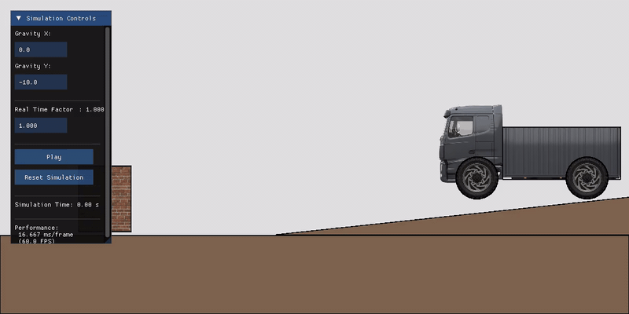
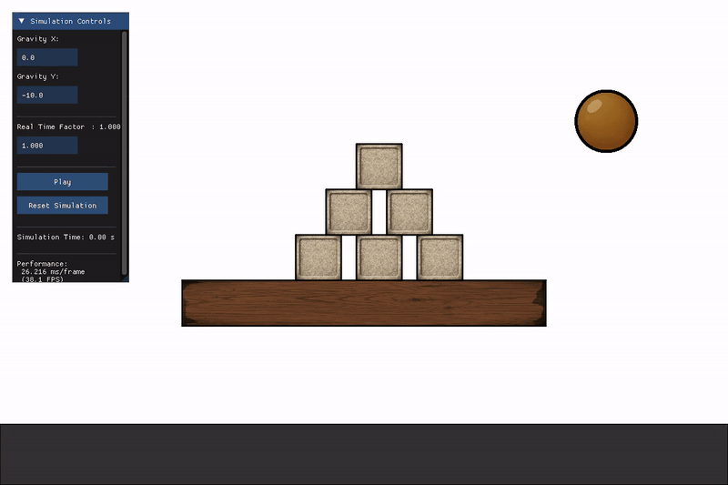
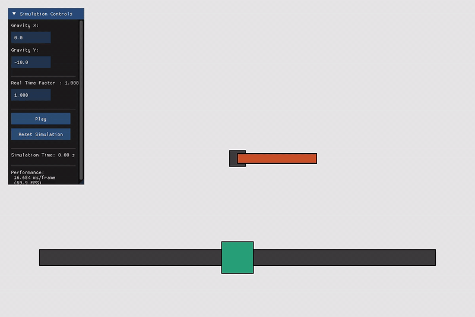

<div align="center">

<h1>
  <picture>
    <source media="(prefers-color-scheme: dark)" srcset="./docs/public/brand/fx2d-logo-dark.svg">
    
  </picture>
</h1>

**Deterministic 2D physics for reinforcement learning and control.**
`pip install fx2d` · Gymnasium environments · many scenes stepped across cores · the same bits on every platform · a C++20 engine with SAT contacts, an XPBD solver and motorized joints.

[](https://pypi.org/project/fx2d/)
[](https://bharath2.github.io/fx2d-physics-engine/)
[](https://en.cppreference.com/w/cpp/20)
[](./LICENSE)
[](https://github.com/Bharath2/fx2d-physics-engine/stargazers)

[**Python and RL**](https://bharath2.github.io/fx2d-physics-engine/guides/python) ·
[**C++ build**](https://bharath2.github.io/fx2d-physics-engine/getting-started/install) ·
[**Demos**](https://bharath2.github.io/fx2d-physics-engine/demos) ·
[**API reference**](https://bharath2.github.io/fx2d-physics-engine/api/) ·
[**Try it in your browser**](https://bharath2.github.io/fx2d-physics-engine/playground) 


</div>

---

## Why Fx2D?

- **Reproducible to the bit.** The same seed and the same actions give the same trajectory on Linux, macOS and Windows, x86-64 and ARM64, from GCC, Clang and MSVC builds, checked by bitwise golden tests on every push. A changed result is a real change, never noise.
- **Gymnasium-native.** `pip install fx2d` installs prebuilt wheels. `gym.make("fx2d/Push-v0")` builds an environment, and `gym.make_vec(..., num_envs=256)` builds a vector environment whose physics runs in one call.
- **Batched on every core.** `fx2d.step_many` steps independent scenes in parallel with the GIL released, and each scene ends with exactly the bits it gives when stepped alone.
- **Your own environments in a few lines.** Build scenes in Python from boxes and circles, or in YAML from any shape, polygons, capsules and chains included, with joints driven by position, velocity or effort motors, contacts, ray casts and NumPy views of the state.
- **Physics you can read.** One explicit pipeline, from broad phase to SAT contacts to a substepped XPBD solver, with [solver](https://bharath2.github.io/fx2d-physics-engine/concepts/xpbd) and [collision](https://bharath2.github.io/fx2d-physics-engine/concepts/collisions) docs that derive the equations the code implements.

## Quick start

```bash
pip install "fx2d[gym]"
```

```python
import gymnasium as gym
import fx2d.envs  # registers the environments

envs = gym.make_vec("fx2d/Push-v0", num_envs=64)
obs, info = envs.reset(seed=0)
for _ in range(1000):
    obs, reward, terminated, truncated, info = envs.step(envs.action_space.sample())
```

Or build a scene and step it yourself:

```python
import fx2d

scene = fx2d.Scene(size=(20, 10), gravity=(0, -10))
scene.add_box("ground", position=(10, 0.5), size=(20, 1), static=True)
scene.add_box("crate", position=(10, 5), size=(1, 1), angle=0.3)
scene.step(1 / 60, steps=120)
print(scene.poses())  # every body's (x, y, angle) as a NumPy array
```

The [Python guide](https://bharath2.github.io/fx2d-physics-engine/guides/python) covers bodies, joints and motors, contacts, YAML scenes, `step_many` and writing your own environments.

## Environments

| id | task | actions |
|---|---|---|
| `fx2d/Push-v0` | push a box onto a goal with a disc, seen from above, on a floor with drag; contacts with friction turn the box | force on the disc, 2-D in [-1, 1] |
| `fx2d/CartPole-v0` | keep a pole hinged on a sliding cart upright | push left or right |
| `fx2d/Pendulum-v0` | swing a rod up with a motor too weak to lift it, and hold it upright | torque in [-2, 2] N m |

Each is an ordinary `fx2d.Scene` with joints and contacts, a pattern to copy for your own tasks. Throughput through `gym.make_vec`, in environment steps per second, on an 8-core Intel i7-11800H laptop under Linux ([benchmarks/python](./benchmarks/python/throughput.py)):

| `fx2d/Push-v0` | 16 copies | 64 copies | 256 copies |
|---|---|---|---|
| Gymnasium `SyncVectorEnv` | 17,900 | 18,300 | 18,600 |
| fx2d vector environment | 25,200 | 32,700 | 49,800 |

The physics alone runs about 4-6x faster across 256 scenes than stepping them one by one. CartPole and Pendulum are so cheap to simulate that Python's share of each step dominates, and they gain only from batches of hundreds.

## C++

The engine is a C++20 static library whose physics needs only the standard library; YAML loading adds yaml-cpp, which CMake downloads if it is not installed.

```bash
git clone https://github.com/Bharath2/fx2d-physics-engine.git
cd fx2d-physics-engine
cmake -S . -B build-headless -DCMAKE_BUILD_TYPE=Release -DFX2D_HEADLESS=ON -DFX2D_BUILD_EXAMPLES=ON
cmake --build build-headless -j      # downloads yaml-cpp if it is not installed
./build-headless/Fx2DTests           # run the test suite
./build-headless/truck_headless      # step a scene with no window
```

Then write a scene and step it:

```yaml
# Scene.yml
scene:
  size: [16, 9]
  gravity: [0, -9.81]

entities:
  floor:
    pose: [8, 0.5, 0]
    physics: { mass: 0, gravity_scale: 0 }
    collision: { geometry: { rectangle: [16, 1] } }

  ball:
    pose: [8, 7, 0]
    physics: { mass: 1.0, elasticity: 0.5 }
    collision: { geometry: { circle: 0.25 } }
```

```cpp
#include "Fx2D/Scene.h"
#include "Fx2D/YamlUtils.h"

int main() {
    auto scene = FxYAML::buildScene("Scene.yml");
    auto ball  = scene.get_entity("ball");
    for (int i = 0; i < 600; ++i) {
        scene.step(1.0 / 60.0);          // fixed timestep, deterministic
        std::cout << ball->pose << '\n'; // x, y, theta
    }
}
```

Want a window? Include `Fx2D/Core.h` instead and hand the scene to the renderer:

```cpp
#include "Fx2D/Core.h"

int main() {
    auto scene = FxYAML::buildScene("Scene.yml");
    FxRylbRenderer renderer(scene, 60);
    renderer.run();
}
```

The [installation guide](https://bharath2.github.io/fx2d-physics-engine/getting-started/install) covers the visual build (raylib, Dear ImGui, rlImGui) on Linux, macOS, Windows and MSYS2.

## Features

| Area | What you get |
|---|---|
| **Python** | `pip install fx2d`: scenes, bodies, joints, contacts and ray casts, NumPy state, `step_many`, Gymnasium and vector environments |
| **Shapes** | Circles, capsules, edges, chains for terrain, and convex or rounded polygons |
| **Collision** | Dynamic AABB tree, SAT contacts with clipped manifolds, opt-in speculative CCD |
| **Solver** | Substepped XPBD with friction, restitution, drag, warm starting, sleeping and a vectorised contact solve |
| **Joints** | Revolute and prismatic joints with PID motors, plus a mouse joint for click-and-drag |
| **Queries & events** | Ray casts, overlap and point queries, begin/end contact events and sensors |
| **Scenes** | YAML scenes with textures and joints, entity groups, collision filtering and one-call reset |
| **Viewer & input** | raylib viewer with an ImGui inspector; keyboard and mouse input that also works headless |
| **Platforms** | x86-64 and ARM64, tested with GCC, Clang, Apple Clang and MSVC |

## Examples

Every example is a plain C++ file plus a `Scene.yml` under [`examples/`](./examples/). Build them with `-DFX2D_BUILD_EXAMPLES=ON` and run from the repository root so asset paths resolve.

<table>
  <tr>
    <td align="center" width="50%">
      <a href="./examples/playground/"></a><br />
      <b><a href="./examples/playground/">Playground</a></b><br />
      <sub>Mouse joint drag, spawn shapes, seesaw, chain ramp. Also runs in the browser</sub>
    </td>
    <td align="center" width="50%">
      <a href="./examples/angry_boxes/"></a><br />
      <b><a href="./examples/angry_boxes/">Angry boxes</a></b><br />
      <sub>Mouse slingshot, trajectory preview, contact impulses, reset</sub>
    </td>
  </tr>
  <tr>
    <td align="center" width="50%">
      <a href="./examples/truck/"></a><br />
      <b><a href="./examples/truck/">Truck</a></b><br />
      <sub>Wheels, suspension joints, textured bodies</sub>
    </td>
    <td align="center" width="50%">
      <a href="./examples/stacked_boxes/"></a><br />
      <b><a href="./examples/stacked_boxes/">Stacked boxes</a></b><br />
      <sub>Resting stability, friction, textured shapes</sub>
    </td>
  </tr>
  <tr>
    <td align="center" width="50%">
      <a href="./examples/joint_control_demo/"></a><br />
      <b><a href="./examples/joint_control_demo/">Joint control</a></b><br />
      <sub>Revolute and prismatic motors: position, velocity, effort modes</sub>
    </td>
    <td align="center" width="50%">
      <a href="./examples/chain_terrain/"></a><br />
      <b><a href="./examples/chain_terrain/">Chain terrain</a></b><br />
      <sub>Polyline terrain, click-to-spawn, one-sided chain contacts</sub>
    </td>
  </tr>
  <tr>
    <td align="center" width="50%">
      <a href="./examples/bucket_fill/"></a><br />
      <b><a href="./examples/bucket_fill/">Bucket fill</a></b><br />
      <sub>Hundreds of bodies piling into a container, sleeping, broad phase under load</sub>
    </td>
    <td width="50%"></td>
  </tr>
</table>

```bash
cmake -S . -B build -DCMAKE_BUILD_TYPE=Release -DFX2D_BUILD_EXAMPLES=ON
cmake --build build -j
./build/example_playground       # also: example_angry_boxes, example_truck, example_stacked_boxes,
                                 # example_joint_control, example_chain_terrain, example_bucket_fill
```

## Headless simulation in C++

The physics core has no dependency on the renderer. Build with `-DFX2D_HEADLESS=ON` (or `./scripts/build_headless.sh`) and you get the same engine with no raylib, no Dear ImGui and no window, which is what CI runs.

```cpp
FxScene scene = FxYAML::buildScene("examples/angry_boxes/Scene.yml");

// Drive the scene the way a player would, without a cursor.
scene.input().set_mouse_position(world_xy, screen_xy);
scene.input().set_mouse_button(FxMouseButton::Left, true);
scene.step(dt);

// Observe: contacts, impulses, ray casts, overlaps.
for (const auto& c : scene.contacts()) { /* c.entity1, c.normal, c.jn_accumulated */ }
FxRayHit hit;
if (scene.raycast(origin, direction, max_distance, hit)) { /* hit.entity, hit.point */ }
scene.reset();  // back to the authored scene, groups included
```

Each scene steps on one thread, so independent scenes run in parallel across threads or processes; from Python, `fx2d.step_many` does this for you. See the [headless guide](https://bharath2.github.io/fx2d-physics-engine/guides/headless), [input](https://bharath2.github.io/fx2d-physics-engine/guides/input), [queries](https://bharath2.github.io/fx2d-physics-engine/guides/queries) and [contacts and sensors](https://bharath2.github.io/fx2d-physics-engine/guides/events).

## Dependencies

CMake 3.16+ and a C++20 compiler. The YAML scene loader uses yaml-cpp, and the windowed viewer uses raylib 4.5+, Dear ImGui and rlImGui; CMake downloads any of them that are not installed. The [installation guide](https://bharath2.github.io/fx2d-physics-engine/getting-started/install) lists the system packages raylib needs on Linux.

## Documentation

The [documentation site](https://bharath2.github.io/fx2d-physics-engine/) has the guides, demos, browser playground and API reference. To browse the same pages on GitHub, including the roadmap, start from the [docs index](./docs/README.md).

## Contributing

Contributions are welcome. See [CONTRIBUTING](./docs/contributing.md) for the workflow, the lint gate (`./scripts/lint.sh`) and how to run the test suite.

If Fx2D is useful to you, a ⭐ on the repository helps others find it.

## Citation

```bibtex
@software{fx2d,
  author  = {Irigireddy, Bharath Chandra},
  title   = {Fx2D: A 2D rigid-body physics engine in C++20},
  year    = {2025},
  url     = {https://github.com/Bharath2/fx2d-physics-engine}
}
```

## License

[BSD-3-Clause](./LICENSE)
